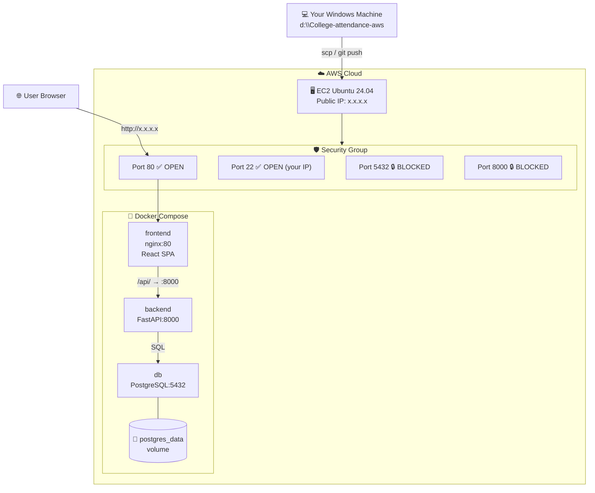

# AWS Deployment Guide – College Attendance App

## What You'll Deploy

```
Your Laptop  ──git push──▶  GitHub
                                │
                           (ssh / scp)
                                ▼
                    ┌─────────────────────┐
                    │   AWS EC2 (Ubuntu)   │
                    │                     │
                    │  ┌───────────────┐  │
                    │  │  nginx  :80   │◀─┼──── Internet (port 80 OPEN)
                    │  └──────┬────────┘  │
                    │         │           │
                    │  ┌──────▼────────┐  │
                    │  │  FastAPI :8000│  │  ← PRIVATE (no host port)
                    │  └──────┬────────┘  │
                    │         │           │
                    │  ┌──────▼────────┐  │
                    │  │ PostgreSQL    │  │  ← PRIVATE (no host port)
                    │  │    :5432      │  │
                    │  └───────────────┘  │
                    └─────────────────────┘
```

---

## STEP 1 — Launch an EC2 Instance

### In AWS Console → EC2 → Launch Instance

| Setting | Value |
|---------|-------|
| **Name** | `college-attendance-server` |
| **AMI** | Ubuntu Server 24.04 LTS (free tier eligible) |
| **Instance type** | `t2.micro` (free tier) or `t3.small` for better performance |
| **Key pair** | Create new → name it `college-key` → download `.pem` file (keep it safe!) |
| **Storage** | 20 GB gp3 (enough for Docker images + DB data) |

> [!IMPORTANT]
> Save the `.pem` file immediately after download. AWS will **never** let you download it again. Put it in a safe folder like `C:\Users\YourName\.ssh\college-key.pem`

---

## STEP 2 — Configure Security Group (Firewall)

During instance launch, under **"Network settings"** → **"Edit"**:

| Type | Port | Source | Why |
|------|------|--------|-----|
| SSH | 22 | **My IP** | Only you can SSH in |
| HTTP | 80 | **0.0.0.0/0** | Public web access |

> [!CAUTION]
> Do **NOT** add rules for port 5432 (PostgreSQL) or 8000 (FastAPI).
> Those stay 100% private inside Docker — never expose them.

---

## STEP 3 — Connect to Your EC2

### On Windows — using PowerShell

```powershell
# Fix key permissions (required by SSH)
icacls "C:\Users\YourName\.ssh\college-key.pem" /inheritance:r /grant:r "$($env:USERNAME):(R)"

# SSH into your EC2 (replace with your actual Public IP from AWS Console)
ssh -i "C:\Users\YourName\.ssh\college-key.pem" ubuntu@YOUR_EC2_PUBLIC_IP
```

> [!TIP]
> Find your EC2 Public IP in AWS Console → EC2 → Instances → click your instance → **"Public IPv4 address"**

---

## STEP 4 — Install Docker on EC2

Run these commands **inside your EC2 terminal** (after SSH):

```bash
# Update packages
sudo apt-get update -y && sudo apt-get upgrade -y

# Install Docker dependencies
sudo apt-get install -y ca-certificates curl gnupg lsb-release

# Add Docker's official GPG key
sudo install -m 0755 -d /etc/apt/keyrings
curl -fsSL https://download.docker.com/linux/ubuntu/gpg | \
  sudo gpg --dearmor -o /etc/apt/keyrings/docker.gpg
sudo chmod a+r /etc/apt/keyrings/docker.gpg

# Add Docker repository
echo \
  "deb [arch=$(dpkg --print-architecture) signed-by=/etc/apt/keyrings/docker.gpg] \
  https://download.docker.com/linux/ubuntu $(lsb_release -cs) stable" | \
  sudo tee /etc/apt/sources.list.d/docker.list > /dev/null

# Install Docker Engine + Compose plugin
sudo apt-get update -y
sudo apt-get install -y docker-ce docker-ce-cli containerd.io \
  docker-buildx-plugin docker-compose-plugin

# Allow ubuntu user to run docker without sudo (log out & back in after this)
sudo usermod -aG docker ubuntu

# Verify installation
docker --version
docker compose version
```

```
# Expected output:
Docker version 27.x.x
Docker Compose version v2.x.x
```

---

## STEP 5 — Upload Your Project to EC2

### Option A — Using SCP (copy files directly)

Run this **from your Windows machine** (not EC2):

```powershell
# Upload the entire project folder
scp -i "C:\Users\YourName\.ssh\college-key.pem" -r `
  "d:\College-attendance-aws" `
  ubuntu@YOUR_EC2_PUBLIC_IP:/home/ubuntu/college-attendance
```

### Option B — Using Git (recommended for future updates)

```bash
# On EC2 — clone from GitHub
git clone https://github.com/YOUR_GITHUB_USERNAME/College-attendance-aws.git \
  /home/ubuntu/college-attendance
```

> [!NOTE]
> If you use Git, you can later update the server with just:
> `git pull && docker compose up -d --build`

---

## STEP 6 — Create the `.env` File on EC2

```bash
# Navigate to the project
cd /home/ubuntu/college-attendance

# Copy the template
cp .env.example .env

# Edit it with your real values
nano .env
```

**Set these values in `.env`:**

```bash
# PostgreSQL credentials
DB_NAME=college_attendance
DB_USER=attendance_user
DB_PASSWORD=MyStr0ng@Pass123        # ← CHANGE THIS to something strong

# Your EC2's public IP or domain
FRONTEND_ORIGINS=http://YOUR_EC2_PUBLIC_IP
```

Save and exit nano: `Ctrl+O` → `Enter` → `Ctrl+X`

> [!CAUTION]
> Never use a weak password like `change_me` or `123456` on a live server.
> Use at least 16 characters with letters, numbers, and symbols.

---

## STEP 7 — Build and Launch with Docker Compose

```bash
cd /home/ubuntu/college-attendance

# Build all images and start all containers in background
sudo docker compose up -d --build
```

This will:
1. 🐘 Pull **PostgreSQL 16** image and initialize your schema
2. 🐍 **Build** the FastAPI image from `backend/Dockerfile`
3. ⚛️ **Build** the React app (npm build) and package into nginx image
4. 🚀 Start all 3 containers, in the right order (db → backend → frontend)

**Watch the build progress:**
```bash
sudo docker compose logs -f
# Press Ctrl+C to stop watching logs (containers keep running)
```

**Check everything is running:**
```bash
sudo docker compose ps
```

Expected output:
```
NAME                      STATUS          PORTS
college-attendance-db-1         running (healthy)
college-attendance-backend-1    running (healthy)
college-attendance-frontend-1   running           0.0.0.0:80->80/tcp
```

---

## STEP 8 — Verify It's Working

### Check ports (security verification)
```bash
sudo ss -tlnp | grep -E ':80|:8000|:5432'

# You should ONLY see port 80:
# LISTEN  0  511  0.0.0.0:80   ← nginx (public) ✅
# Port 8000 and 5432 should NOT appear ← private ✅
```

### Test the API
```bash
curl http://localhost/api/health
# → {"status": "ok"}

curl http://localhost/api/students
# → []  (empty array, ready to add students)
```

### Open the app in your browser
```
http://YOUR_EC2_PUBLIC_IP
```

---

## Complete Flow Diagram



---

## Ongoing Management Commands

```bash
# View live logs
sudo docker compose logs -f

# View logs for one service
sudo docker compose logs -f backend

# Restart a service (e.g. after a bug fix)
sudo docker compose restart backend

# Stop everything (data is preserved in volume)
sudo docker compose down

# Update after code changes
git pull
sudo docker compose up -d --build

# Check disk usage
docker system df

# Clean up unused images (free disk space)
docker image prune -f
```

---

## Common Problems & Fixes

| Problem | Likely Cause | Fix |
|---------|-------------|-----|
| Site not loading | Security Group missing port 80 | Add HTTP inbound rule in AWS Console |
| `DB_PASSWORD must be set` error | `.env` not created | Run `cp .env.example .env` then edit it |
| Backend keeps restarting | DB not ready yet | Wait 30s; run `docker compose logs db` |
| `permission denied` running docker | Not in docker group | Run `sudo docker compose ...` or log out & back in |
| Old code still showing | Browser cached JS | Hard refresh: `Ctrl+Shift+R` |
| EC2 runs out of disk | Too many old images | Run `docker image prune -f` |

---

## Cost Estimate (AWS Free Tier)

| Resource | Free Tier | After Free Tier |
|----------|-----------|-----------------|
| EC2 `t2.micro` | 750 hrs/month free (12 months) | ~\$8.50/month |
| EBS Storage 20GB | 30 GB free | ~\$1.60/month |
| Data Transfer | 15 GB out free | \$0.09/GB |
| **Total** | **\$0 for 12 months** | **~\$10/month** |

> [!TIP]
> **Stop** (not terminate) your EC2 instance when not using it to avoid charges.
> Go to EC2 Console → select instance → Instance State → **Stop**.
> Stopped instances still incur storage costs but not compute costs.
