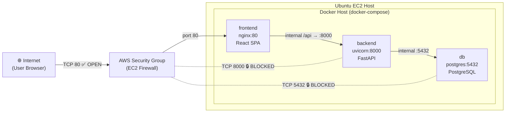
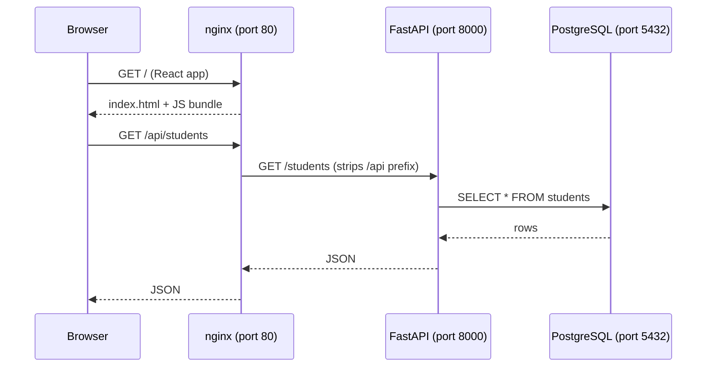

# Docker Deployment – College Attendance App on EC2

## Project Understanding

Your app is a **React + FastAPI + (originally MySQL → now PostgreSQL)** full-stack attendance management system:

| Layer | Technology | Purpose |
|---|---|---|
| Frontend | React 18 + Vite → nginx | SPA: students, courses, attendance, dashboard |
| Backend | FastAPI + SQLAlchemy | REST API with 8 endpoints |
| Database | PostgreSQL 16 | Persistent storage (students, courses, attendance) |

---

## Architecture on EC2



---

## Port Exposure Summary

| Port | Bound to Host? | Accessible from Internet? | Service | Reason |
|------|---------------|--------------------------|---------|--------|
| **80** | ✅ Yes (`0.0.0.0:80`) | ✅ **PUBLIC** | nginx (React + API proxy) | Users need this to access the site |
| **8000** | ❌ No | 🔒 **PRIVATE** | FastAPI backend | Reached only by nginx via Docker internal network |
| **5432** | ❌ No | 🔒 **PRIVATE** | PostgreSQL | Reached only by FastAPI via Docker internal network |

> [!IMPORTANT]
> The `db` and `backend` services have **no `ports:` mapping** in `docker-compose.yml`. They exist only on the `internal` Docker bridge network. Even if someone scanned your EC2, they cannot reach PostgreSQL or FastAPI directly.

---

## Files Created / Changed

### New Files

| File | Purpose |
|------|---------|
| `backend/Dockerfile` | 2-stage Python image: build deps → slim runtime |
| `frontend/Dockerfile` | 2-stage: Node build → nginx serve |
| `frontend/nginx.conf` | Serves SPA + reverse-proxies `/api/` → backend:8000 |
| `docker-compose.yml` | Orchestrates all 3 services with health checks |
| `.env.example` | Root-level env template for production |
| `deploy.sh` | One-shot Ubuntu EC2 bootstrap script |

### Modified Files

| File | What Changed |
|------|-------------|
| `backend/requirements.txt` | `pymysql` → `psycopg2-binary` (PostgreSQL driver) |
| `backend/app/config.py` | Driver `mysql+pymysql` → `postgresql+psycopg2`, port `3306` → `5432` |
| `database/schema.sql` | Rewritten for PostgreSQL (`SERIAL`, `CHECK` constraint, `IF NOT EXISTS` indexes) |
| `backend/.env.example` | Updated host/port for PostgreSQL container |
| `frontend/.env.example` | `VITE_API_BASE_URL=/api` (relative, nginx handles routing) |

---

## How the Pieces Fit Together



> [!NOTE]
> The frontend is built at **Docker build time** with `VITE_API_BASE_URL=/api`. The `/api` prefix is a relative path — the browser sends requests to the same host on port 80, nginx intercepts them and strips `/api` before forwarding to FastAPI internally.

---

## EC2 Deployment Steps

### 1. Security Group (AWS Console)

| Rule | Port | Source |
|------|------|--------|
| HTTP | 80 | `0.0.0.0/0` |
| SSH | 22 | Your IP only |
| *(no rule)* | 5432 | – (blocked) |
| *(no rule)* | 8000 | – (blocked) |

### 2. First-time Setup on the Instance

```bash
# SSH into your EC2
ssh -i your-key.pem ubuntu@YOUR_EC2_IP

# Upload your project (from your machine):
# scp -r -i your-key.pem d:\College-attendance-aws ubuntu@YOUR_EC2_IP:/opt/college-attendance

# On EC2 – run the deploy script
cd /opt/college-attendance
chmod +x deploy.sh
sudo ./deploy.sh
```

### 3. Manual Steps (if not using deploy.sh)

```bash
# Install Docker
sudo apt-get update
sudo apt-get install -y docker-ce docker-ce-cli containerd.io docker-compose-plugin

# Create .env
cp .env.example .env
nano .env    # Set DB_PASSWORD and FRONTEND_ORIGINS

# Launch
sudo docker compose up -d --build

# Check status
sudo docker compose ps
sudo ss -tlnp | grep -E '80|8000|5432'
```

### 4. Verify Port Exposure

```bash
# Should show ONLY port 80 listening on 0.0.0.0
sudo ss -tlnp | grep -E '80|8000|5432'
# Expected:
#   LISTEN  0  511  0.0.0.0:80   users:(("docker-proxy",...))
# Port 8000 and 5432 should NOT appear (they're internal-only)

# Confirm the app is up
curl http://localhost/api/health
# → {"status": "ok"}
```

---

## Useful Commands After Deployment

```bash
# View logs
sudo docker compose logs -f

# Restart a service
sudo docker compose restart backend

# Stop everything
sudo docker compose down

# Stop and DELETE database data
sudo docker compose down -v   # ⚠ destroys postgres_data volume

# Rebuild after code changes
sudo docker compose up -d --build frontend backend
```

---

## Why These Design Decisions?

| Decision | Reason |
|----------|--------|
| **MySQL → PostgreSQL** | Task requirement; also PostgreSQL is better supported on AWS RDS if you scale later |
| **nginx reverse-proxy** | Single public port (80); hides backend URL; handles SPA routing (try_files) |
| **`/api` prefix** | No hardcoded IP in the React build; works behind any domain or load balancer |
| **`depends_on: condition: service_healthy`** | FastAPI waits for Postgres to be ready; prevents startup crashes |
| **Named volume `postgres_data`** | Data survives `docker compose restart`; only lost on `docker compose down -v` |
| **Non-root user in backend** | Security best practice – container runs as `appuser`, not root |
| **2-stage Dockerfiles** | Final images don't include build tools → smaller, fewer CVEs |

